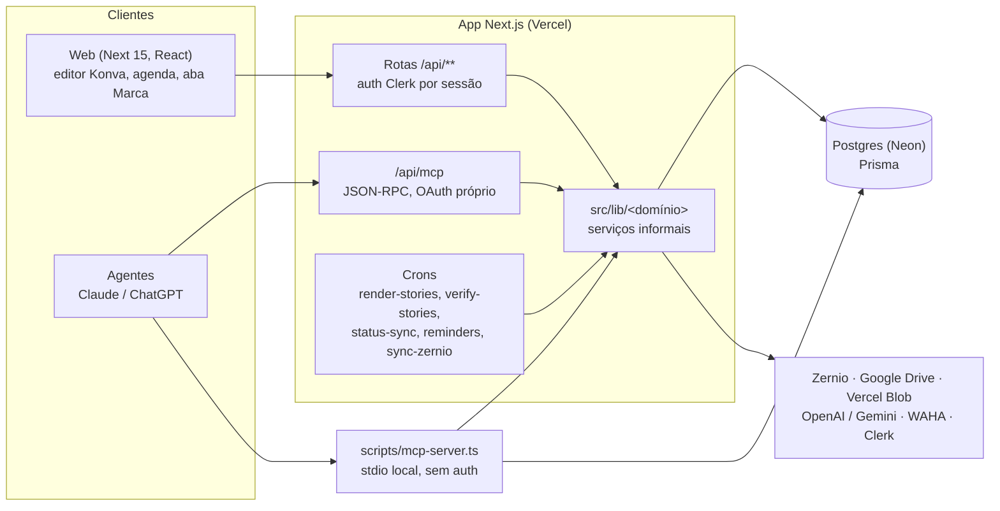
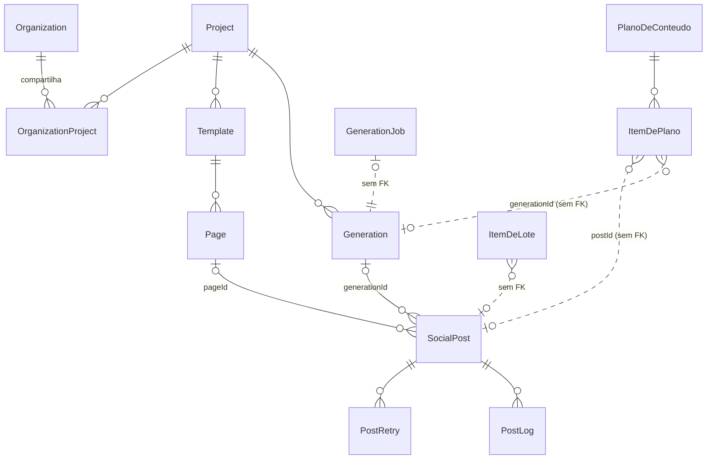
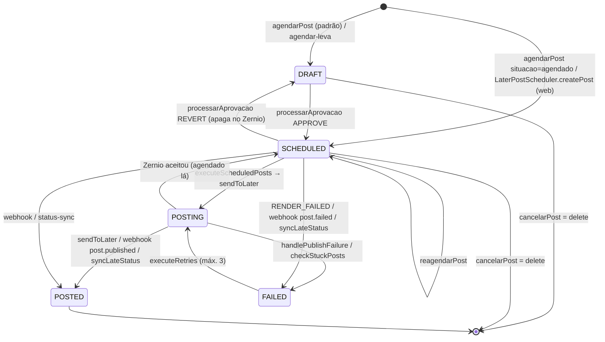

# Arquitetura atual do Studio Lagosta

Auditoria de 12/10/2026, sobre `origin/main` em `f509b0fd` (PR #201). Só leitura: nenhum código
foi alterado. Os números de linha foram conferidos de novo em `137a1e7e`, depois do PR #202, que
só tocou em `arte-rapida.ts` e no catálogo de modelos do MCP. Os caminhos são relativos à raiz do repositório e `schema` é `prisma/schema.prisma`.

Rótulos usados em todo o documento:

- **CONFIRMADO** — lido no código, com caminho e linha.
- **INFERIDO** — conclusão tirada do código, sem execução que a prove.
- **DESCONHECIDO** — não deu para determinar só pelo repositório.

Os números de linha são do commit auditado e envelhecem. Os nomes de função continuam valendo
para o `grep`.

---

## 1. Visão geral



Pontos marcados no diagrama:

- O stdio fala com o banco por fora dos serviços, num `PrismaClient` próprio. CONFIRMADO
  (`scripts/mcp-server.ts:33`).
- Não há server actions (`"use server"` não aparece em `src`). `src/server` tem um único arquivo, `google-drive-service.ts`, importado por rotas. CONFIRMADO.

---

## 2. Editor e modelo do documento

### 2.1 Persistência

| Entidade | O que é | Evidência |
|---|---|---|
| `Template` | Pasta de páginas: `type`, `dimensions`, `designData` (legado), `dynamicFields` (morto), `textAutofixEnabled` | schema:1088 — CONFIRMADO |
| `Page` | **O documento de verdade**: `layers Json`, `width/height`, `background`, `audio`, `tags[]`, `isTemplate`, `copyAutoral` | schema:1120 — CONFIRMADO |
| `Generation` | A arte produzida: `resultUrl`, `status`, `fieldValues Json` (mais de 40 chaves sem schema) | schema:102 — CONFIRMADO |
| `Element` | Asset enviado; não é um nó do documento | schema:76 — CONFIRMADO |

- `Page.layers` tem **três codificações** no banco: array nativo, string JSON e string
  duplamente codificada. Por isso existe o leitor defensivo `lerCamadas`
  (`src/lib/posts/page-layers.ts:54`). CONFIRMADO.

### 2.2 O tipo `Layer` (`src/types/template.ts:38-140`), abreviado

```ts
type LayerType = 'text'|'rich-text'|'image'|'gradient'|'gradient2'|'logo'|'element'|'shape'|'icon'|'video'
interface Layer {
  id; type; name; visible; locked; order
  position: {x,y}; size: {width,height}; rotation?
  content?; fileUrl?; logoId?; elementId?
  style?          // tipografia, gradiente, crop (frações 0..1), mask, filtros
  isDynamic?      // só imagem; texto não tem marcação
  textboxConfig?  // anchor top|middle|bottom, autoWrap, autoResize
  parentId?       // declarado, remapeado na duplicação, NUNCA interpretado
  metadata?       // groupId, compositor{papel,bloco,...}, iconeDe, stackOrder...
  effects?; richTextStyles?; videoMetadata?; clipe?; movimento?
  [key: string]: unknown
}
```

### 2.3 Respostas pontuais (todas CONFIRMADAS)

| Tema | Como está hoje |
|---|---|
| Estrutura | **Lista plana** por página. Não é árvore. |
| Grupos | Etiqueta `metadata.groupId`. A seleção expande para os irmãos (`konva-editor-stage.tsx:413`). Não há transformação de grupo. |
| Frames e contêineres | Não existem. As coordenadas são absolutas na página. |
| IDs | String por camada. Há ids reservados com significado: `bg-foto`, `logo`, `gradiente-leitura-*` (`compositor/camadas-extras.ts:106`). |
| Ordem de empilhamento | `order` reescrito como índice do array a cada escrita (`template-editor-context.tsx:185`). |
| Constraints | Só `textboxConfig.anchor` para texto, mais o reflow por delta vertical do grupo (`combo-stack-reflow.ts`). |
| Snapping e alinhamento | `konva-smart-guides.ts`, `konva-alignment.ts`. Operam sobre **nós Konva**, não sobre o modelo. |
| Seleção múltipla | `selectedLayerIds` no contexto do editor. |
| Crop e máscara | `style.crop` em frações; `style.mask` é um path SVG em viewBox 100. |
| Texto | `text` e `rich-text` com estilos por trecho; entrelinha em dois campos com precedência implícita (`layer-contract.ts:12`). |
| Componentes reutilizáveis | `FontCombination.elements` (posição relativa 0..1). Ao inserir, vira camadas soltas com `groupId`, sem vínculo com o original. |
| Undo/redo | Snapshot do `DesignData` inteiro, 50 por página, com agrupamento de 800 ms (`historico-do-editor.ts`). Não há log de operações. |
| Gravação | O PageSync grava o array **inteiro** (debounce de 800 ms, fila serial). Há também o PATCH por camada (`api/pages/[pageId]/layers/[layerId]`). No servidor, ver a seção 2.4. |
| Render | **O modelo é compartilhado, os renderizadores não**: Konva no browser (`konva-layer-factory.tsx`), Canvas2D/`@napi-rs/canvas` no servidor (`render-engine.ts`). O servidor ignora `video`. A paridade é mantida à mão. |

**Scene graph:** não existe. Existe um array plano com vínculos implícitos em `metadata`
(`groupId`, `iconeDe`, `elementoDe`, `stackOrder`). INFERIDO a partir dos itens acima.

### 2.4 Gravação no servidor: `gravarCamadasComRevisao`

A gravação comum já existe: `gravarCamadasComRevisao` (`src/lib/copy-autoral/persistir.ts:93`).
CONFIRMADO.

- **Conflito:**
  - relê a página a cada volta e grava com compare-and-set em `updatedAt`, até 4 voltas;
  - se perder a corrida em todas, lança `PAGINA_MUDOU_DURANTE` (409) e não grava nada.
- **Camadas:** vêm de uma função calculada sobre a página **relida**. São gravadas como **string
  JSON**.
- **Contrato da copy:** `Page.copyAutoral` é revisado **na mesma escrita**
  (`revisaoDaPaginaComCamadas`). Se o contrato recusar, as camadas vão, o contrato fica e um
  `aviso` volta.
- **Autoria:** `{ autor, motivo, superficie }`; `humana` reconcilia a marca "escondida pelo
  revisor".
- **Transação:** recebe o cliente de quem chama (o `db` ou a `tx`).

| Caminho | Usa `gravarCamadasComRevisao`? | Invalidação |
|---|---|---|
| PATCH de camada (`api/pages/[pageId]/layers/[layerId]`) | **Sim** | `invalidateScheduledRenders(tx)` dentro da transação; recomposição depois |
| PUT do template (`api/templates/[id]`) | **Sim** | dentro da transação; recomposição depois |
| `reverterCamadasDaArte` (`compositor/reverter.ts`) | **Sim** | `invalidateScheduledRenders(tx)` dentro da transação (`:56`); recomposição depois (`:69`) |
| PATCH da página / editor (`api/templates/[id]/pages/[pageId]`) | **Não**: laço de CAS próprio e revisão inline (`:266-312`) | dentro da transação; recomposição depois |
| `ajustarArte` (`creatives/arte-rapida.ts:963`; o laço começa em `:1182`) | **Não**: laço próprio com `isTemplate: false` | **fora** da transação, depois do render |
| Recomposição (`compositor/recompor.ts:543`) | **Não**: CAS próprio | `invalidateScheduledRenders(db)` fora da transação quando recompõe (`:715`); não pede outra recomposição |

O próprio cabeçalho de `persistir.ts` registra que esses três últimos "têm a mesma regra escrita
no próprio laço". CONFIRMADO.

---

## 3. Semântica do criativo

Há **seis vocabulários paralelos**, todos CONFIRMADOS:

| # | Vocabulário | Onde |
|---|---|---|
| 1 | **Papéis do compositor** `pre, headline, headline2, apoio, cta, servico`, gravados em `metadata.compositor.papel` | `compositor/papel-do-nome.ts:13` (`PAPEIS_DO_COMPOSITOR`; `PAPEIS` em `spec.ts:18` não inclui `headline2`), `blocos.ts:192` |
| 2 | **Funções da copy autoral** `pre, headline, apoio, cta, servico, livre`, em tabela lateral `Page.copyAutoral` ligada pela `metadata.compositor.bloco` | `copy-autoral/contrato.ts:69` |
| 3 | `horario` / `endereco` **deduzidos por regex** no texto do `servico` | `ai/blocos-de-servico.ts:128` |
| 4 | Combinações de texto: `role: title/subtitle/body` | `font-combinations-schema.ts:66` |
| 5 | Gerador legado e presets: `title, subtitle, cta, badge, address, hours, footer_info_*` | `ai-creative-generator/layout-templates.ts`, `instagram-template-presets.ts` |
| 6 | Papel de referência de imagem (não é camada) | `api/projects/[projectId]/arte-ia/route.ts:25` |

Existem também duas leituras de papel com regras diferentes. CONFIRMADO.

- **`papelDaCamada`** é exata: `metadata.compositor.papel` → `id` → `name`
  (`compositor/defasagem.ts:164`).
- **`papelDoNome`** aceita sinônimos como `titulo`, `manchete`, `rodape`, `footer`
  (`compositor/papel-do-nome.ts:20`).

O que o sistema já distingue:

| Papel pedido | Hoje |
|---|---|
| headline / subheadline / cta | Sim (`headline`, `headline2`, `apoio`, `cta`) |
| logo | Por `type:'logo'` ou `id:'logo'` |
| hero_image | Só por `id:'bg-foto'` ou `isDynamic`; não há papel |
| footer | Só como sinônimo de `servico` |
| address / opening_hours | Por regex no texto; não é declarado |
| offer / price / badge | **Não existem** no caminho vivo (preço é `servico` por convenção do cliente) |

Uma camada criada à mão no editor só tem semântica se o `name` cair num sinônimo. INFERIDO.

---

## 4. Templates

| Pergunta | Resposta | Rótulo |
|---|---|---|
| O template é um documento completo? | Não. O `Template` é uma pasta, e a unidade é a `Page`. O "modelo" é uma página com `isTemplate = true`. | CONFIRMADO |
| Quem decide o que vale no render? | `slotValuesParaRender`: se a página é modelo, valem os `slotValues` do post; se é conteúdo, vale a página (`posts/copy-segue-a-pagina.ts:82`). | CONFIRMADO |
| É clonado? | Sim em `criar-arte-de-modelo` e no `create-from-template` (nova `Page` com `isTemplate = false`). **Não** no story agendado, que renderiza o próprio modelo a cada vez (`story-renderer.ts:77`). | CONFIRMADO |
| Mantém referência ao original? | Fraca: `Generation.sourcePageId` sem FK, `fieldValues.sourcePageId`, a string `AICreativeGeneration.layoutType = "template:<id>"`. | CONFIRMADO |
| Placeholders e slots? | **Não há slot declarado.** O slot é qualquer camada casada por `id` ou `name` (`page-to-design-data.ts:85`). Chave sem camada gera só um `warn`. `dynamicFields` é morto. | CONFIRMADO |
| Regras do conteúdo variável | Não há limite por camada. O contrato limita a 12 linhas e a spec a 300 caracteres por linha. | CONFIRMADO |
| Trocar a imagem preserva o crop? | Troca só o `fileUrl`. O crop manual da foto antiga vale para a nova, e sem `objectFit:'cover'` a imagem é esticada (`image-fit.ts:25`). | CONFIRMADO (o risco é INFERIDO) |
| Trocar o texto pode quebrar o layout? | Sim. O reflow e o autofix protegem, mas **o story agendado e o `create-from-template` fazem só o reflow, sem autofix**. | CONFIRMADO |
| Redimensionar é determinístico? | Não. "Redimensionar" troca só o canvas, e as camadas ficam onde estão (`resize-panel.tsx:59`). O multiformato existe só na geração (compositor `story/feed/quadrado`). | CONFIRMADO |
| Os assets da marca entram sozinhos? | Em parte: a logo entra no compositor e as fontes por `role`. As cores **não**, e os gradientes estão fixos no código por `projectId` (`assets/gradients-library.ts:80`). | CONFIRMADO |

### 4.1 As vias de preenchimento e edição têm contratos diferentes

Não há pipeline único, e não deve haver. CONFIRMADO linha a linha:

| Via | Reflow | Autofix | Persistência | Render |
|---|---|---|---|---|
| `compor` (`comporPeca`) | não (o layout nasce medido) | sim (`compor.ts:1003`) | página nova (`persistAndRenderCreative`) | PNG na hora |
| `ajustar-arte` (`ajustarArte`) | sim, mas pulado quando há ajustes sem troca de texto (`arte-rapida.ts:1066`) | sim | CAS próprio, recusa modelo | PNG (`renderPageAndRegister`) |
| `criar-arte-de-modelo` (`createArteRapida`) | sim (`:704`) | sim (`:708`) | página nova | PNG na hora |
| editor (PATCH da página) | no browser (INFERIDO) | não | CAS próprio | depois, no cron |
| story/post agendado (`renderStoryImage`) | sim (`story-renderer.ts:108`) | **não** | não grava camadas, só `mediaUrls` | PNG no cron |
| criar do template (UI) | sim | não | página nova | não |

O detalhe de cada via está na seção 3 da [arquitetura alvo](studio-target-architecture.md).

### 4.2 O executor de ajustes: `aplicarAjustes`

`src/lib/creatives/revisao/aplicar-ajustes.ts:272`. CONFIRMADO.

- **Natureza:** função pura, com o medidor injetado.
- **Operações:** `fonte`, `mover`, `gradiente`, `visibilidade` e `caixa`.
- **Endereçamento:** só por id de camada; o gradiente aceita id ou `borda`.
- **Recusas:** ajuste incompleto, camada inexistente, tipo errado. Nunca aplica pela metade.
- **Reflow próprio:** a pilha da mesma coluna e o elemento ligado ao texto acompanham.
- **Saída:** devolve `alteradas`, que o autofix confere.
- **Quem chama:** em produção, só o `ajustarArte`, que exige `versaoEsperada`. Fora da produção, também o script `scripts/revisar-antes-depois.ts`.
- **Testes:** `revisao/__tests__/aplicar-ajustes.test.ts`.

### 4.3 Papéis se repetem

O compositor gera `servico` e `servico-2` (`compositor/camadas-extras.ts:102`). A leitura da copy
devolve os dois "juntos, de cima para baixo" (`compositor/defasagem.ts:191`).

A **duplicação de página regenera os ids das camadas**. Antes da troca, ela transforma em marca
na camada (papel e bloco) todo vínculo que dependia do id físico (`copy-autoral/duplicacao.ts`,
`materializarVinculosDoIdFisico`). CONFIRMADO.

Ou seja: o `layer.id` não é identidade estável entre cópias, e o papel não é único.

### 4.4 Compositor

**O compositor é um segundo sistema de template**, guiado por papéis: spec + "assinatura" →
`Layer[]` → página editável.

- O estilo vem das páginas do template chamado **"Assinatura"**, achado pelo **nome**. O
  comentário do schema descreve outra regra (tag + `isTemplate`).
- Os números vêm de `Project.assinatura`.
- As variantes são escolhidas por papéis, tema, luz da foto e rodízio (`compor.ts:190`).
- CONFIRMADO.

---

## 5. Marca e DNA

- **Fonte de verdade declarada:** `loadBrandContext` (`src/lib/brand/brand-context.ts:98`) junta
  DNA, fontes, `BrandColor`, logo, `estiloDasReferencias` e voz. A voz vence o DNA quando
  `BrandVoice.migradaEm` está preenchido. CONFIRMADO.
- **Na prática, ela não é única.** CONFIRMADO.
  - `arte-rapida`, `compor` e outros dois loaders leem a marca direto.
  - A regra de escolha da logo diverge (o compositor exige `isProjectLogo`).
  - O estilo visual mora em três lugares: `DNA.visualStyle`, `Project.brandStyleDescription` e
    `estiloDasReferencias`.
  - A base de conhecimento ainda tem a categoria `TOM_DE_VOZ`, legada, que fica fora do
    contexto dos prompts.
- **Referências e peças aprovadas:** a referência de estilo é `Generation.styleRefAt`; o
  feedback de arte vira `LearningSignal`. Não há confiança nem versão no `BrandDNA`; o
  `BrandVoice` tem `versao`. CONFIRMADO.
- **Marca ↔ templates:** pela assinatura (estilo por papel) e pela herança de fonte das
  combinações. **Marca ↔ conteúdo:** pela voz/DNA nos prompts e pela base (fatos: horário,
  cardápio). CONFIRMADO.
- `src/lib/brand-config.ts` é o metadado do site da Lagosta, não marca de cliente. CONFIRMADO.

---

## 6. Conteúdo



Todas as entidades abaixo estão CONFIRMADAS no código.

- **Cliente** = `Project`, compartilhado com `Organization` via `OrganizationProject`.
- **Pauta** = `PlanoDeConteudo` → `ItemDePlano`, com `copyAutoral`, `legenda`, `formato`,
  `via`, `slides` e `status` em TEXT.
- **Copy:** o contrato fica em `Page.copyAutoral`. O `SocialPost.slotValues` tem dois
  sentidos, e quem decide é o `isTemplate` da página.
- **Legenda** = `SocialPost.caption` (no plano, `ItemDePlano.legenda`).
- **Post, story, reel e carrossel:** são valores de `SocialPost.postType`, não entidades.
  - O carrossel é `mediaUrls[]` no post e `carouselGroupId` + `slideOrder` nas Generations.
  - O vídeo é um MP4 em `mediaUrls` com a marca `videoDaPagina`, ou um `VideoProcessingJob`.
- **Conteúdo ↔ criativo:**
  - O post aponta para a arte por FK em `pageId` (re-render) ou `generationId` (`resultUrl`
    congelado).
  - O que vai ao ar é sempre `mediaUrls`, materializado pelo cron `render-stories` (a cada
    2 min, prioridade para os próximos 15 min).
  - Quando a página muda, `invalidateScheduledRenders` **e** `pedirRecomposicaoDaArteCongelada`
    precisam rodar juntas.
- **Aprovação não é entidade.** Aprovar é a transição `DRAFT → SCHEDULED`
  (`processarAprovacao`), sem registro de quem aprovou nem quando. A bancada vive no
  `localStorage`.

---

## 7. Agenda e workflow

### 7.1 Estados que existem (enums em `schema`)

| Enum | Valores |
|---|---|
| `PostStatus` | `DRAFT, SCHEDULED, POSTING, POSTED, FAILED` |
| `RenderStatus` | `NOT_NEEDED, PENDING, RENDERING, RENDERED, RENDER_FAILED` |
| `VerificationStatus` | `PENDING, VERIFIED, VERIFICATION_FAILED, SKIPPED` |
| `RetryStatus` | `PENDING, PROCESSING, SUCCESS, FAILED` |
| `ItemDePlano.status` (TEXT) | `proposto, editado, aprovado, reprovado, na-fila, gerando, pronto, erro, agendado` |

### 7.2 Comparação com o vocabulário-alvo

| Alvo | Hoje |
|---|---|
| draft | `DRAFT` |
| ready | Não existe no post (o mais perto é `RenderStatus.RENDERED`) |
| awaiting_approval | **Não existe**: o `DRAFT` acumula esse papel. INFERIDO |
| approved | **Não existe**: aprovar leva direto a `SCHEDULED` |
| scheduled | `SCHEDULED` ("entregue ao Zernio" = `SCHEDULED` + `laterPostId`, derivado) |
| publishing | `POSTING` |
| published | `POSTED` (+ `VERIFIED` em stories) |
| failed | `FAILED` / `RENDER_FAILED` |
| rejected | **Não existe** no post (só `reprovado` no item do plano) |
| cancelled | **Não existe**: cancelar é `delete` físico (`agenda-acoes.ts:576`); `PostLogEvent.CANCELLED` nunca é usado |

### 7.3 Máquina de estados do `SocialPost`



Todas as transições foram CONFIRMADAS. Três caminhos marcam `FAILED` **sem** chamar
`handlePublishFailure`, contra a regra da casa:

- o webhook `post.failed`, que só tem um `TODO`;
- o `PUT /posts/[postId]`;
- o `syncLateStatus`.

---

## 8. MCP do Studio

| Aspecto | Como está | Rótulo |
|---|---|---|
| Registro | Único (`definirTool`, `src/lib/mcp/registro/`) com hints, `acesso` e superfícies; porta única `executarTool`. **61 tools** (a documentação fala em 48). | CONFIRMADO |
| Transportes | Remoto `/api/mcp` (JSON-RPC escrito à mão: `initialize`, `ping`, `tools/list`, `tools/call`). Stdio `scripts/mcp-server.ts` (SDK). | CONFIRMADO |
| Legadas | **24 tools em inglês só no stdio**, fora do registro e do gate, com Prisma próprio. Seis nomes coincidem com apelidos do remoto, mas os contratos são outros. | CONFIRMADO |
| Resources e prompts | Não existem. | CONFIRMADO |
| Autenticação | Remoto: Bearer de serviço, ou OAuth próprio (DCR, PKCE, refresh rotativo, tokens em hash, escopo único `mcp`). Stdio: sem autenticação. | CONFIRMADO |
| Autorização | Gate por tool (`projeto` / `curador`). **O escopo OAuth não é verificado.** | CONFIRMADO |
| 🔴 Brecha (**corrigida no PR #202**, depois desta auditoria) | O gate só roda quando `projectId` é número (`porta.ts:66`). `escolher-modelo` aceita `projectHint`, e `resolveProject` procura em **todos** os projetos ativos (`arte-rapida.ts:269` em `f509b0fd`). Antes da correção, o usuário OAuth lia modelos de cliente alheio, e o erro `AMBIGUOUS_PROJECT` listava nomes e ids de outros clientes. | CONFIRMADO |
| Escrita destrutiva | `postar-agora`, `cancelar-post` (delete), `arquivar-entrada-base`, `reverter-arte`; nas legadas, `delete-posts` (em massa) e `update-post` (grava status direto). `aprovar-rascunhos` publica, mas está declarada como não destrutiva. | CONFIRMADO |
| Erros | Três formatos: `CreativeError`, `ErroDeTool` (usado uma vez) e texto livre. | CONFIRMADO |
| Auditoria | **Não há registro por chamada** (quem, qual tool, quais argumentos, resultado). Só rastros por domínio (`Generation.canal`, `decididoPor`, `PostLog`). | CONFIRMADO |
| Idempotência | Real em `compor-leva` / `agendar-leva` (`ItemDeLote` + hash). `gerar-imagem` faz dedupe por janela de 10 min. O resto não tem chave. | CONFIRMADO |
| Limites | Sem rate limit. Tetos por tool (60 itens, 12 imagens, 40 camadas). Lotes JSON-RPC rodam em sequência. Os créditos são cobrados dentro dos serviços. | CONFIRMADO |

### 8.1 O MCP chama a camada de negócio ou embute regra?

**Os dois.** No catálogo em português predomina a chamada a serviços (A). CONFIRMADO.

- **(A) Serviço compartilhado com a web:**
  - `agendarPost`, também usado pela bancada;
  - `processarAprovacao`;
  - `startArtGeneration`;
  - `creative-improvement-service`;
  - `plano-service`;
  - `brand-context`;
  - `compositor/reverter`;
  - `creatives/acervo`.
- **(A) Serviço que só o MCP usa:** `reagendarPost`, `editarPost`, `cancelarPost`,
  `lotes/agendar-itens` e `arte-livre`.
- **(B) Regra embutida no handler:**
  - `ver-agenda`;
  - `marcar-como-modelo` (duplica `toggle-template/route.ts`);
  - `marcar-foto-destaque`, `arquivar-entrada-base`, `propor-resposta`, `conferir-arte`;
  - **todas as 24 legadas**.

Divergências já reais entre a web e o MCP, todas CONFIRMADAS:

| Operação | Caminhos |
|---|---|
| Criar post | `PostScheduler` (web, nasce `SCHEDULED`), `agendarPost` (MCP, nasce rascunho), `create-post` legado |
| Cancelar | A web apaga até `POSTED` e engole a falha do Zernio; o MCP recusa e lança `ZERNIO_INDISPONIVEL`; a legada faz uma terceira variante |
| Gravar camadas | Seis caminhos de gravação. Três usam `gravarCamadasComRevisao`: o PATCH de camada, o PUT do template e `reverter`. Três reimplementam o laço: o PATCH do editor, `ajustarArte` (o do MCP) e a recomposição (seção 2.4) |

---

## 9. Camada de comandos

- **Existe uma camada de serviço informal**: funções exportadas em `src/lib/<domínio>` e alguns
  `*-service.ts`. Não há padrão de comando, de entrada e saída, nem de autorização embutida.
  Cada rota e cada handler refaz a autenticação. CONFIRMADO.
- **A autorização está duplicada.** A web usa `hasProjectWriteAccess` com a organização da
  sessão; o MCP usa `projetosVisiveis` / `ehCuradorDoProjeto`. CONFIRMADO.
- **Operações de camada fora do alcance de um agente:**
  - **O que o MCP cobre:** `ajustar-arte` troca textos e a foto e faz cinco ajustes (`fonte`,
    `mover`, `gradiente`, `visibilidade`, `caixa`; `revisao/contrato.ts:82`).
  - **O que fica de fora:** cor, troca de família de fonte, rotação, adicionar ou remover
    camada, ordem de empilhamento, alinhamento, efeitos, páginas, timeline. Também não é
    possível editar uma página-modelo.
  - **Onde essas operações vivem:** só no editor Konva ou em rotas que exigem sessão Clerk.
    CONFIRMADO. Que um agente precisaria do navegador para elas é INFERIDO.

```text
Hoje:
UI ──▶ rotas /api (inline ou serviço) ──┐
                                        ├──▶ src/lib/<domínio> (às vezes) ──▶ Prisma
MCP remoto ──▶ porta ──▶ handler ───────┘
MCP stdio ──▶ handlers legados ───────────────────────────────────────────▶ Prisma
Editor ──▶ mutações no contexto React (layers em memória) ──▶ PATCH da página inteira
```

---

## 10. O que não se sabe

- **Aprovação de copy pelo cliente** (página `revisar-copy`): não aparece no schema e deve
  morar fora deste repositório. DESCONHECIDO.
- **Volume real de `Page.layers` em cada codificação no banco:** precisa de consulta à
  produção, que não foi feita. DESCONHECIDO.
- **Quem usa as 24 tools legadas hoje** (Claudinho? sessões locais?): não há log de chamadas
  para responder. DESCONHECIDO.

---

## Alterações após revisão adversarial

Revisão adversarial do Codex sobre a primeira versão desta auditoria (12/10/2026), com veredito
**needs-attention**. Os quatro achados foram conferidos no código e são **VALIDADOS**. A tabela
completa está na [arquitetura alvo](studio-target-architecture.md#alterações-após-revisão-adversarial).

| Finding | Classificação | O que mudou neste documento |
|---|---|---|
| A gravação ignorava `gravarCamadasComRevisao` e a revisão atômica de `copyAutoral` | VALIDADO | Seção 2.4 nova, e a linha "Gravar camadas" da seção 8.1 corrigida |
| O papel não serve como identidade de slot (papéis se repetem) | VALIDADO | Seção 4.3 nova (`servico`/`servico-2`, ids regenerados na duplicação) |
| Não há pipeline universal bake → reflow → autofix | VALIDADO | Seção 4.1 nova, com o contrato de cada via |
| `aplicarAjustes` já é o executor puro | VALIDADO | Seção 4.2 nova |
